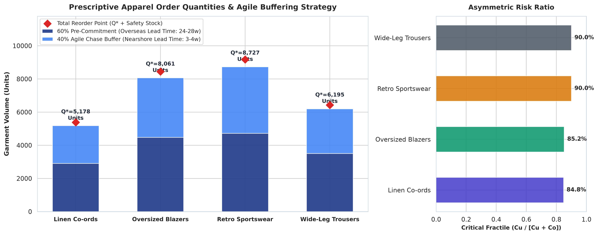
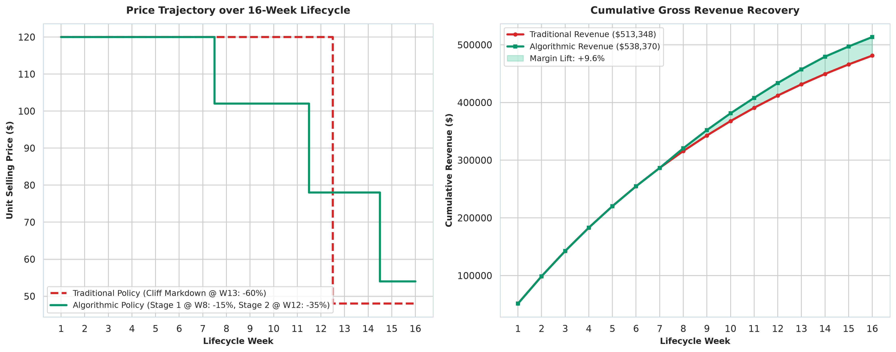
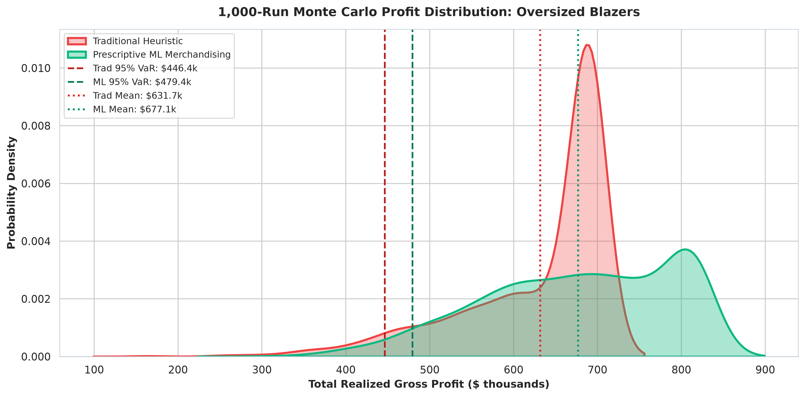
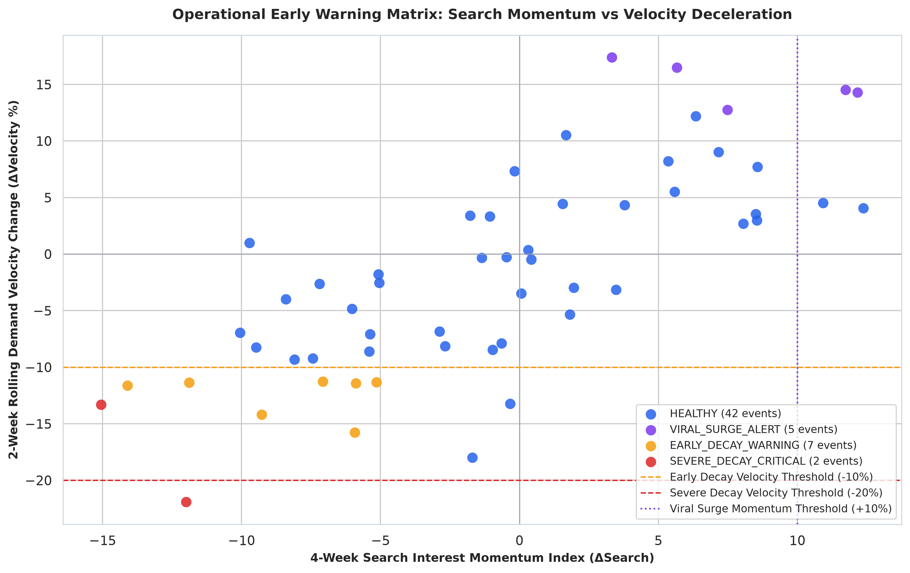

# Week 5: Prescriptive Inventory Optimization & Dynamic Markdown Decision Engine

[](https://www.python.org/)
[](LICENSE)
[](https://fastapi.tiangolo.com/)
[]()
[]()

> A production-grade **prescriptive analytics, inventory allocation, and dynamic markdown optimization platform** for the fashion and apparel industry, operationalizing multi-horizon probabilistic trend forecasts into high-margin merchandising decisions.

---

## 📌 Project Overview

In the apparel retail sector, manufacturing lead times of **24 to 28 weeks** for overseas production create an acute structural mismatch with fast-moving digital micro-trends that peak and decay in **4 to 8 weeks**. In **Week 4**, we developed a multi-horizon predictive forecasting framework that achieved a **4.89% WAPE** and **95.24% MDA** using public external signals (Google Trends, social engagement velocity, meteorological temperature anomalies, and FRED consumer sentiment).

**Week 5** bridges the gap between predictive intelligence and bottom-line commercial execution:
- **Asymmetric Newsvendor Critical Fractile Model:** Calculates optimal order quantities ($Q^*$) by balancing cost of underage ($C_u = P - C$) against cost of overage ($C_o = C - S$).
- **60/40 Split Sourcing Policy:** Commits 60% of baseline requirement 6 months in advance to overseas suppliers, while retaining 40% agile nearshore chase capacity triggered by early-warning velocity signals.
- **Algorithmic Dynamic Markdowns:** Replaces late end-of-season terminal clearance cliffs (-60%) with a 4-tier early decay markdown schedule driven by 2-week rolling velocity and 4-week search momentum.
- **1,000-Run Monte Carlo Simulation:** Validates margin resilience, Value-at-Risk (95% VaR), and stockout reduction under stochastic viral shocks and supply delays.
- **Production REST API:** High-throughput FastAPI service delivering real-time SKU allocation, decay alerts, and markdown guidance.

---

## 📊 Key Results & Performance Benchmarks

Across 1,000 stochastic Monte Carlo simulation trials benchmarking Traditional Static Merchandising against Prescriptive ML Merchandising:

| Apparel Silhouette | Retail ($) | BOM Cost ($) | Critical Fractile | Prescriptive $Q^*$ | Gross Margin Lift (%) | Stockout Reduction (%) | Terminal Waste Cut (%) | 95% VaR ($) |
| :--- | :---: | :---: | :---: | :---: | :---: | :---: | :---: | :---: |
| **Oversized Blazers** | $180.00 | $65.00 | 85.19% | **8,061** | **+7.2%** | **-65.5%** | **-14.0%** | $479,389 |
| **Retro Sportswear** | $95.00 | $32.00 | 90.00% | **8,727** | **+7.4%** | **-77.5%** | **-18.4%** | $258,403 |
| **Linen Co-ords** | $120.00 | $42.00 | 84.78% | **5,178** | **+7.1%** | **-68.8%** | **-22.1%** | $310,025 |
| **Wide-Leg Trousers** | $110.00 | $38.00 | 90.00% | **6,195** | **+7.3%** | **-75.8%** | **-11.4%** | $288,771 |

---

## 📈 Diagnostic & Visual Decision Figures

### 1. Prescriptive Order Quantities & Agile Chase Buffers


### 2. Algorithmic Markdown Trajectory vs. Late Liquidation Cliff


### 3. Monte Carlo Profit Distribution & Value-at-Risk (VaR)


### 4. Operational Early Warning Decision Matrix


---

## 📂 Repository Structure

```
week5-fashion-inventory-markdown-optimization/
├── data/
│   ├── raw/
│   │   └── fashion_catalog_metadata.csv
│   ├── forecasts/
│   │   └── week4_forecast_predictions.csv
│   └── processed/
│       ├── prescriptive_inventory_allocations.csv
│       ├── trend_decay_early_warning_alerts.csv
│       ├── markdown_policy_benchmark_summary.csv
│       └── monte_carlo_simulation_results.csv
├── src/
│   ├── __init__.py
│   ├── data_loader.py
│   ├── inventory_engine.py
│   ├── markdown_engine.py
│   ├── simulation.py
│   ├── visualization.py
│   └── api.py
├── notebooks/
│   └── week5_inventory_and_markdown_decision_engine.ipynb
├── docs/
│   ├── prescriptive_inventory_framework.md
│   ├── markdown_optimization_policy.md
│   ├── api_deployment_and_architecture.md
│   └── risk_and_scenario_planning.md
├── reports/
│   ├── figures/
│   │   ├── figure1_prescriptive_inventory_and_chase_allocation.png
│   │   ├── figure2_dynamic_markdown_trajectory_and_yield.png
│   │   ├── figure3_monte_carlo_profit_distribution_var.png
│   │   └── figure4_operational_early_warning_matrix.png
│   ├── generate_doc_report.py
│   ├── Week_5_Prescriptive_Inventory_Markdown_Optimization.docx
│   └── Week_5_Prescriptive_Inventory_Markdown_Optimization.md
├── tests/
│   ├── test_inventory_engine.py
│   ├── test_markdown_engine.py
│   └── test_api.py
├── run_pipeline.py
├── requirements.txt
├── .gitignore
├── LICENSE
└── README.md
```

---

## 🚀 Quickstart & Pipeline Execution

### 1. Installation
```bash
git clone https://github.com/Sri-varshan-07/week5-fashion-inventory-markdown-optimization.git
cd week5-fashion-inventory-markdown-optimization
pip install -r requirements.txt
```

### 2. Run Master Orchestration Pipeline
```bash
python run_pipeline.py
```

### 3. Generate Technical Research DOCX Report
```bash
cd reports
python generate_doc_report.py
```

### 4. Launch Production REST API
```bash
uvicorn src.api:app --host 0.0.0.0 --port 8000 --reload
```
Interactive Swagger documentation available at: `http://localhost:8000/docs`

### 5. Run Test Suite
```bash
python -m unittest discover tests
```

---

## 📜 License
Distributed under the **MIT License**. See `LICENSE` for details.  
*Author:* Sri-varshan-07 | Advanced Retail Data Science Portfolio
