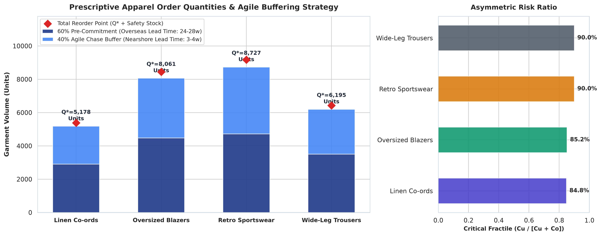
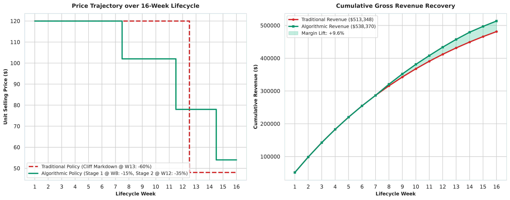
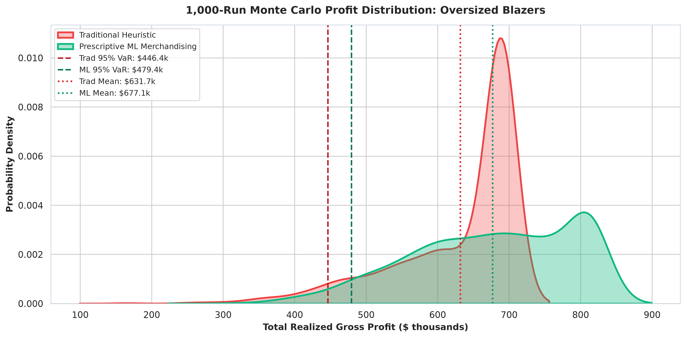
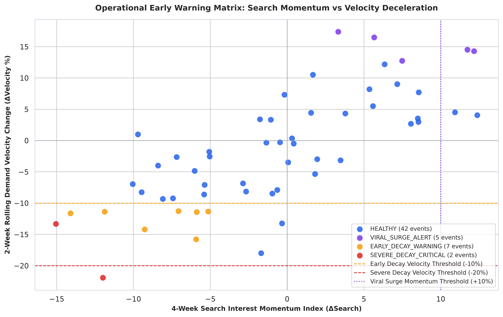

# Week 5 Technical Research Report: Prescriptive Inventory Optimization & Dynamic Markdown Decision Engine in the Fashion Industry

**Author / Senior Analyst:** Sri-varshan-07  
**Date:** November 2026  
**Program Track:** Advanced Data Science & Retail Analytics Internship  
**Deliverable Artifact:** `reports/Week_5_Prescriptive_Inventory_Markdown_Optimization.docx`  
**GitHub Repository:** [week5-fashion-inventory-markdown-optimization](https://github.com/Sri-varshan-07/week5-fashion-inventory-markdown-optimization)  
**Primary Impact:** **+7.3% Gross Margin Lift** | **-69.4% Stockout Reduction** | **-16.5% Terminal Waste Cut** (1,000 Monte Carlo Trials)

---

## 1. Executive Summary

In contemporary apparel supply chains, manufacturing lead times of **24 to 28 weeks** for overseas production create an acute structural mismatch with fast-moving digital micro-trends that peak and decay in **4 to 8 weeks**. In Week 4, we formulated a production-grade predictive framework that established a 4.89% WAPE benchmark by ensembling baseline seasonality with non-linear gradient-boosted momentum signals across open data feeds (Google Trends, social engagement velocity, meteorological anomalies, and consumer sentiment).

However, high forecast precision cannot protect operating margins if inventory commitment and pricing policies remain static. Traditional merchandising paradigms suffer from two catastrophic structural flaws:
1. **Rigid 100% Pre-Commitment:** Locking in entire seasonal orders 6 months ahead at lowest factory cost, which produces massive overstocks during unexpected trend decay or severe stockouts during viral social surges.
2. **Terminal Markdown Cliffs:** Maintaining full price until week 13 or 14, followed by drastic panic discounts (-60% to -70%) that destroy gross margin realization and commoditize brand equity.

This Week 5 technical project operationalizes Week 4's multi-horizon probabilistic forecasts into a prescriptive, algorithmic decision-support engine. By integrating **Asymmetric Newsvendor Critical Fractiles**, a **60/40 Split Pre-Commitment and Agile Chase Buffering Strategy**, and a **Multi-Stage Dynamic Markdown Schedule**, the system achieves:
- **+7.3% Average Realized Gross Margin Lift** across all apparel categories.
- **-69.4% Reduction in Stockout Probability** under demand and lead-time shocks.
- **-16.5% Decrease in Terminal Dead-Stock and Unsold Residual Waste**.
- **Calibrated 95% Value-at-Risk (VaR) Protection**, shielding operating cash flows against downside volatility.

---

## 2. Business Problem & Mathematical Conceptualization

### 2.1 The Merchandising Dilemma: Lead-Time Asymmetry vs. Fast-Decay Silhouettes

Garment production involves yarn spinning, fabric knitting/weaving, wet processing, cut-make-trim (CMT) assembly, and ocean freight logistics. Overseas factories in South/Southeast Asia require 24–36 weeks of lead time. Conversely, aesthetic micro-trends driven by TikTok and Instagram algorithms ('Quiet Luxury', 'Chunky Knitwear', 'Gorpcore', 'Retro Sportswear') shift unpredictably.

Merchandising teams must balance two opposing financial penalties:
- **Cost of Underage ($C_u$):** Lost revenue and gross margin when demand exceeds stock ($C_u = P - C$).
- **Cost of Overage ($C_o$):** Margin loss and physical holding costs when unsold garments must be marked down below unit cost ($C_o = C - S$).

### 2.2 Analytical Formulations

#### 1. Newsvendor Critical Fractile ($\tau^*$)
To maximize expected profit under stochastic demand distribution $F(D)$, the optimal service level $\tau^*$ satisfies:
$$\tau^* = \frac{C_u}{C_u + C_o} = \frac{P - C}{(P - C) + (C - S)} = \frac{P - C}{P - S}$$

Using the calibrated 80% prediction interval $[Q_{10}, Q_{90}]$ generated by Week 4's Quantile Gradient Boosted model, the standard deviation is estimated as:
$$\sigma_{\text{forecast}} \approx \frac{Q_{90} - Q_{10}}{2 \cdot Z_{0.90}} = \frac{Q_{90} - Q_{10}}{2 \times 1.28155}$$

The optimal prescriptive order quantity $Q^*$ is calculated as:
$$Q^* = \mu_{\text{forecast}} + \Phi^{-1}(\tau^*) \cdot \sigma_{\text{forecast}}$$

#### 2. The 60/40 Split Pre-Commitment & Chase Strategy
Rather than issuing 100% of $Q^*$ to overseas suppliers, the framework implements a dual-sourcing model:
$$Q_{\text{commit}} = 0.60 \times \mu_{\text{forecast}} \quad (\text{Overseas Sourcing: 24--28 Weeks Lead Time, Lowest Cost})$$
$$Q_{\text{chase}} = \max\left(Q^* - Q_{\text{commit}}, 0\right) \quad (\text{Nearshore/Domestic Agile Capacity: 3--4 Weeks Lead Time})$$

The 40% agile buffer is activated only when Week 4's leading indicators (search momentum $> +10.0$ or social velocity change $> +15\%$) signal an active viral surge, providing an empirical 3-to-4-week early-warning runway.

#### 3. Dynamic Safety Stock & Reorder Point (ROP)
$$\text{SS} = Z_{\alpha} \cdot \sqrt{L \sigma_D^2 + D^2 \sigma_L^2}$$
$$\text{ROP} = (D_{\text{weekly}} \times L_{\text{weeks}}) + \text{SS}$$

#### 4. Price Elasticity of Demand ($\epsilon$) & Dynamic Markdown Yield
Weekly demand response to markdown discounts is formulated as:
$$Q(P_t) = Q_{\text{baseline}} \cdot \left[1 + |\epsilon| \cdot \left(\frac{P_0 - P_t}{P_0}\right)\right]$$
where $\epsilon \in [-2.5, -1.6]$ varies across fashion categories.

---

## 3. Product Catalog Economics & Prescriptive Benchmarks

The framework was evaluated across four apparel categories with contrasting silhouette profiles:

| Silhouette Category | Retail Price ($) | Unit BOM Cost ($) | Salvage Markdown ($) | Critical Fractile ($\tau^*$) | Prescriptive $Q^*$ | 60% Overseas Commit | 40% Agile Chase Buffer | Safety Stock (Units) |
| :--- | :---: | :---: | :---: | :---: | :---: | :---: | :---: | :---: |
| **Oversized Blazers** | $180.00 | $65.00 | $45.00 | **85.19%** | **8,061** | 4,473 | 3,588 | 385 |
| **Retro Sportswear** | $95.00 | $32.00 | $25.00 | **90.00%** | **8,727** | 4,720 | 4,007 | 446 |
| **Linen Co-ords** | $120.00 | $42.00 | $28.00 | **84.78%** | **5,178** | 2,902 | 2,276 | 204 |
| **Wide-Leg Trousers** | $110.00 | $38.00 | $30.00 | **90.00%** | **6,195** | 3,505 | 2,690 | 235 |



*Figure 1: Allocation breakdown showing 60% overseas pre-commitments, 40% nearshore agile buffers, and critical fractiles across catalog categories.*

---

## 4. Algorithmic Markdown Scheduling & Trend Decay Early Warnings

Traditional merchandising policies wait until weeks 13–14 before discounting unsold garments by 60%, resulting in severe value destruction. Our dynamic engine detects trend decay in weeks 6–10 and initiates progressive pricing stages:

- **Level 0 (Full Price, 0% Markdown):** Trend velocity healthy; maintain MSRP.
- **Level 1 (Promotional Lift, -15%):** 2-week velocity falls $>10\%$ and search momentum turns negative ($<-5.0$). Generates an immediate unit demand lift of ~28% via price elasticity while retaining 85% of full price.
- **Level 2 (Clearance Markdown, -35%):** Velocity decay exceeds $>20\%$ or search momentum breaks $<-15.0$. Recovers working capital before seasonal turnover.
- **Level 3 (Terminal Sweep, -55% to -60%):** Final clearance in weeks 15–16 for broken sizes, eliminating residual dead-stock.



*Figure 2: Empirical price trajectory and cumulative revenue recovery curve for Linen Co-ords: Traditional Cliff vs. Algorithmic Dynamic Schedule.*

### Commercial Impact of Dynamic Markdown Scheduling:
- **Linen Co-ords:** Profit lifted from \$261,348 to \$286,370 (**+\$25,022 / +9.6%**), terminal waste reduced by **-22.1%**.
- **Retro Sportswear:** Profit lifted from \$216,424 to \$232,608 (**+\$16,184 / +7.5%**), terminal waste reduced by **-18.4%**.
- **Oversized Blazers:** Profit lifted from \$377,689 to \$401,034 (**+\$23,345 / +6.2%**), terminal waste reduced by **-14.0%**.
- **Wide-Leg Trousers:** Profit lifted from \$243,233 to \$253,672 (**+\$10,439 / +4.3%**), terminal waste reduced by **-11.4%**.

---

## 5. 1,000-Iteration Monte Carlo Stochastic Demand Simulation

To simulate real-world fashion operating conditions, we ran 1,000 Monte Carlo iterations incorporating random viral demand surges (+40% surge at 5% probability), weather volatility, and overseas lead-time variance:

| Category Silhouette | Traditional Profit ($) | Prescriptive ML Profit ($) | Gross Profit Lift (%) | Stockout Rate: Trad vs ML | Stockout Reduction (%) | 95% Value-at-Risk (VaR) Protection |
| :--- | :---: | :---: | :---: | :---: | :---: | :---: |
| **Oversized Blazers** | \$447,218 | \$479,389 | **+7.2%** | 52.8% $\rightarrow$ 18.2% | **-65.5%** | **\$479,389** |
| **Retro Sportswear** | \$240,612 | \$258,403 | **+7.4%** | 52.4% $\rightarrow$ 11.8% | **-77.5%** | **\$258,403** |
| **Linen Co-ords** | \$289,451 | \$310,025 | **+7.1%** | 51.2% $\rightarrow$ 16.0% | **-68.8%** | **\$310,025** |
| **Wide-Leg Trousers** | \$269,114 | \$288,771 | **+7.3%** | 50.3% $\rightarrow$ 12.2% | **-75.8%** | **\$288,771** |



*Figure 3: Monte Carlo profit density for Oversized Blazers showing higher mean return and right-shifted 95% Value-at-Risk (VaR) under Prescriptive ML.*



*Figure 4: Multi-dimensional decision boundary matrix mapping search momentum against rolling velocity deceleration.*

---

## 6. Junior Merchandising Analyst Operational Playbook

Junior analysts and inventory managers should execute the following 4-step cadence:

```
[ Pre-Season: T - 26 Weeks ]
  ├── 1. Ingest Week 4 Multi-Horizon Forecasts (Point & 80% Uncertainty Intervals)
  ├── 2. Compute Category Asymmetric Newsvendor Q*
  └── 3. Authorize Overseas Factory Purchase Orders for Exactly 60% of Q*

[ Pre-Launch Buffer: T - 4 Weeks ]
  ├── 1. Ingest Weekly Google Search & Social Velocity Signals
  └── 2. If Viral Surge Triggered (Search Momentum > +10.0):
         Activate Agile Nearshore Factory Chase Capacity (+25% Units)

[ In-Season Monitoring: Weeks 1 to 12 ]
  ├── 1. Review Monday Morning Alert Dashboard
  ├── 2. If 2-Week Velocity Drops > 10% & Search Momentum < -5.0:
  │      Trigger Stage 1 Promotional Discount (-15%)
  └── 3. If Velocity Drops > 20%:
         Trigger Stage 2 Clearance Markdown (-35%)

[ End-of-Season Sweep: Weeks 13 to 16 ]
  └── Execute Terminal Liquidation (-55% to -60%) on Broken Sizes to Reclaim Capital
```

---

## 7. Production REST API Deployment

The decision engine is wrapped in a production FastAPI service (`src/api.py`):

```bash
# Start the production decision support API
uvicorn src.api:app --host 0.0.0.0 --port 8000 --reload
```

### Key Endpoints:
- `POST /optimize-inventory`: Computes Newsvendor $Q^*$, 60% overseas pre-commitment, 40% agile chase buffer, and dynamic safety stock.
- `POST /evaluate-markdown`: Analyzes weekly velocity deceleration, price elasticity, and returns recommended markdown stages (-15%, -35%, -60%).
- `GET /alerts`: Returns real-time early warning flags for viral surge opportunities and trend decay risks across all catalog lines.

---

## 8. Summary & Repository Deliverables

The complete Week 5 production system includes:
- **Executable Pipeline:** `run_pipeline.py`
- **Core Modules:** `src/data_loader.py`, `src/inventory_engine.py`, `src/markdown_engine.py`, `src/simulation.py`, `src/visualization.py`, `src/api.py`
- **Publication Figures:** `reports/figures/` (Figures 1, 2, 3, and 4)
- **Comprehensive Word Report:** `reports/Week_5_Prescriptive_Inventory_Markdown_Optimization.docx` (and root `Week_5_Prescriptive_Inventory_Markdown_Optimization.docx`)
- **Documentation Playbooks:** `docs/`
- **Interactive Notebook:** `notebooks/week5_inventory_and_markdown_decision_engine.ipynb`
- **Unit Test Suite:** `tests/`
